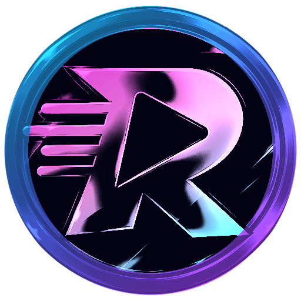

# RapidTunes

**Votre bibliothèque musicale, votre lecteur et vos téléchargements — réunis dans une application Windows.**

[**Télécharger RapidTunes**](https://github.com/Ghost-FaceFR/RapidTunes/releases/latest) · [Voir les nouveautés](CHANGELOG.md)

---

## Découvrez RapidTunes

RapidTunes réunit un lecteur multimédia et **Media DL** dans une application de bureau pensée pour Windows. Écoutez et organisez vos médias locaux, personnalisez votre expérience, ou lancez un téléchargement depuis un lien ou une recherche — sans jongler entre plusieurs outils.

## Ce que vous pouvez faire

### Écouter et organiser votre bibliothèque

- Parcourir vos fichiers et dossiers audio ou vidéo dans une bibliothèque locale.
- Créer des playlists, gérer la file de lecture, mélanger les titres et régler la vitesse de lecture.
- Modifier les informations et les pochettes de vos médias.
- Profiter du plein écran pour les vidéos et d'un mini lecteur compact, avec visualisation et option toujours au premier plan.
- Personnaliser le son avec l'égaliseur et ses préréglages, puis choisir parmi plusieurs visualisations audio.

### Trouver et télécharger avec Media DL

- Saisir un lien ou rechercher un média, une vidéo ou une playlist.
- Choisir parmi plusieurs formats audio et vidéo, dont MP3, MP4, WAV, FLAC et AAC. Les choix disponibles dépendent du média source.
- Suivre les téléchargements dans une file d'attente : progression et vitesse en temps réel, pause, reprise, annulation et limitation du débit.
- Retrouver les téléchargements précédents dans l'historique et ouvrir directement leur emplacement.

### Une application qui s'adapte à vous

- Choisir un thème et des couleurs personnalisées.
- Utiliser une interface disponible en français.
- Recevoir les mises à jour intégrées et les installer depuis l'application.

## Télécharger et installer

1. Téléchargez le dernier installateur stable depuis la page [**Releases**](https://github.com/Ghost-FaceFR/RapidTunes/releases/latest).
2. Ouvrez `RapidTunes_<version>_x64-setup.exe` et suivez les étapes de l'installateur.
3. Au premier lancement, RapidTunes installe automatiquement les composants nécessaires, notamment yt-dlp, FFmpeg et Deno.

Si RapidTunes est déjà installé, l'installateur peut proposer de mettre à jour, réparer ou désinstaller l'application. La suppression des données peut être choisie lors de la désinstallation.

> **Avertissement Windows :** l'installateur n'étant pas signé numériquement, Windows peut afficher un avertissement d'éditeur inconnu. Téléchargez-le uniquement depuis les Releases officielles et vérifiez son empreinte SHA-256 affichée sur la page de publication.

## Configuration requise

- Windows 10 ou Windows 11, 64 bits.
- Une connexion Internet pour l'installation initiale des composants, les recherches, les téléchargements et les mises à jour.

La lecture de médias déjà présents sur votre ordinateur reste accessible hors ligne. La disponibilité des téléchargements dépend des plateformes sources et de leurs conditions d'utilisation. Veillez à disposer des droits nécessaires pour les médias que vous téléchargez.

## Aide rapide

- **Installer une mise à jour :** utilisez la recherche de mise à jour depuis la page « À propos » de l'application, ou téléchargez l'installateur depuis les [Releases](https://github.com/Ghost-FaceFR/RapidTunes/releases/latest).
- **Consulter l'historique des versions :** ouvrez le [journal des modifications](CHANGELOG.md).
- **Signaler un problème de sécurité :** consultez [SECURITY.md](SECURITY.md).

## Licence et transparence

RapidTunes est un logiciel propriétaire et **n'est pas open source**. Ce dépôt public contient les installateurs et les informations destinées aux utilisateurs ; le code source de l'application n'y est pas publié.

- [Contrat de licence](LICENSE)
- [Conditions d'utilisation](legal/TERMS.md)
- [Confidentialité et données](legal/PRIVACY.md)
- [Conditions de vente](legal/SALES_TERMS.md)
- [Sécurité](SECURITY.md)
- [Crédits](legal/CREDITS.md)
- [Composants tiers](legal/THIRD_PARTY_NOTICES.md)

Ces documents sont également consultables dans l'application, sous « À propos » puis « Mentions légales ».

---

© 2026 **Ghost Industry**. Tous droits réservés.

